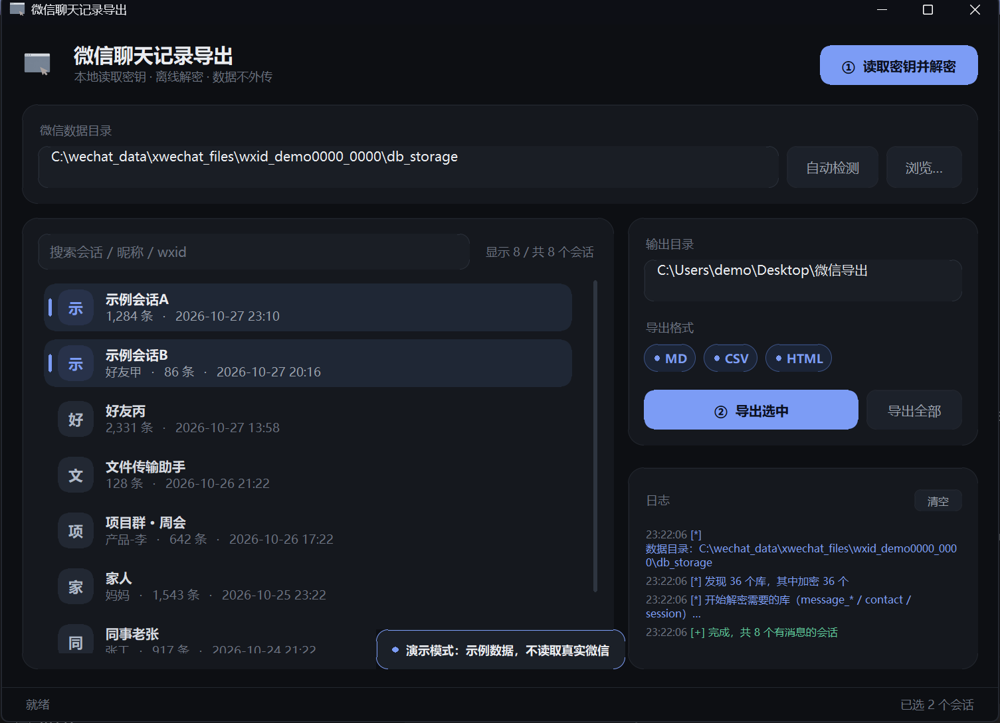

# 微信聊天记录导出（Windows GUI）

一个单文件 exe：从**正在运行**的微信 4.x 进程里取 SQLCipher 密钥 → 本地逐页解密 → 挑会话 → 导出
**MD / CSV / HTML**。全程离线，只有本机文件读写，不发任何网络请求。



> 预览图就是 `WXGUI_DEMO=1` 演示模式（示例数据，不读真实微信），仓库里可以随时复现这张图。

---

## 一、界面

### 1.1 窗口骨架

```
┌──────────────────────────────────────────────────────────────────────────┐
│ [icon] 微信聊天记录导出                          ┌────────────────────┐  │
│        本地读取密钥 · 离线解密 · 数据不外传      │ ① 读取密钥并解密   │  │
│                                                  └────────────────────┘  │
├──────────────────────────────────────────────────────────────────────────┤
│  微信数据目录                                                            │
│  [ …\xwechat_files\wxid_xxx\db_storage              ] [自动检测] [浏览…] │
├──────────────────────────────────────────┬───────────────────────────────┤
│ [搜索会话 / 昵称 / wxid]   显示 8 / 共 8 │  输出目录                     │
│ ┌──┬───────────────────┬──────────────┐ │  [ …\Desktop\微信导出 ] [浏览…]│
│ │示│ 示例会话A │ 1,284 条 …   │ │  导出格式                     │
│ ├──┼───────────────────┼──────────────┤ │  (● MD) (● CSV) (● HTML)      │
│ │示│ 示例会话B  好友甲     │ 86 条 …      │ │  ┌──────────────┐ ┌────────┐ │
│ │  │ …（自绘行 / 多选）  │              │ │  │ ② 导出选中   │ │导出全部│ │
│ └──┴───────────────────┴──────────────┘ │  └──────────────┘ └────────┘ │
│                                          ├───────────────────────────────┤
│                                          │  日志                  [清空] │
│                                          │  19:15:41 [*] 数据目录：…     │
│                                          │  19:15:41 [+] 完成，共 8 个…  │
├──────────────────────────────────────────┴───────────────────────────────┤
│ ▁▁▁▁▁▁ 2px 进度细线（仅忙碌时出现）                                      │
│ 就绪                                              已选 2 个会话           │
└──────────────────────────────────────────────────────────────────────────┘
```

默认 1180×800（按屏幕自动收缩），最小 1000×700，尺寸与位置存进 `config.json`。

### 1.2 各区块

| 区块 | 内容与行为 |
|---|---|
| **顶部** | 40px 应用图标 + 标题「微信聊天记录导出」+ 副标题「本地读取密钥 · 离线解密 · 数据不外传」；右上角主按钮 **① 读取密钥并解密** |
| **数据目录卡片** | 标签「微信数据目录」；输入框占位 `…\xwechat_files\wxid_xxx\db_storage`；右侧幽灵按钮「自动检测」「浏览…」。自动检测读 `%APPDATA%\Tencent\xwechat\config\*.ini`，多账号时日志会补一句「（另有 N 个账号目录）」 |
| **会话卡片** | 搜索框（占位「搜索会话 / 昵称 / wxid」，输入即时过滤，匹配备注/昵称/wxid 三个字段）；右上计数「显示 N / 共 M 个会话」；下面是自绘虚拟列表：**56px 行高、36px 圆角方块首字头像、名称粗体、第二行「昵称 · N 条 · 最后消息时间」**（昵称与名称相同时省略昵称），选中行圆角高亮 + 左侧强调色竖条，悬停行浅高亮、鼠标变手型，6px 细滚动条 |
| **导出卡片** | 「输出目录」输入框 + 「浏览…」（默认 `桌面\微信导出`）；「导出格式」三枚胶囊开关 **MD / CSV / HTML**（默认全开，圆点勾选）；主按钮 **② 导出选中** + 幽灵按钮 **导出全部** |
| **日志卡片** | 标题「日志」+ 右上小按钮「清空」；按级别着色：`[*]` 信息（强调蓝）、`[+]`/`[✓]` 成功（绿）、`[!]` 警告（黄）、`[x]` 错误（红），自动滚到底 |
| **状态栏** | 左侧状态文字（`就绪` / `正在读取密钥` / `正在读取会话` / `正在导出 3 / 8`，忙碌时尾部 ` ·` 呼吸点）；右侧「已选 N 个会话」；忙碌时上方浮出 2px 强调色进度细线（来回扫动） |
| **Toast 浮层** | 底部居中的圆角提示条，四种语气：info（演示模式）、ok（导出完成，已打开输出目录）、warn（先选目录 / 先选会话 / 至少勾选一种格式）、err（出错：…）；默认 2.8s 自动消失（错误 3.6s、演示提示 5s） |

### 1.3 操作要点

- **多选**：`单击` 选中、`Ctrl+单击` 增减、`Shift+单击` 连选、`Ctrl+A` 全选当前过滤结果
  （先点一下列表让它拿到焦点；除这个之外没有别的快捷键 —— 自绘按钮不可 Tab 聚焦）。
- **双击某行** = 只导出该会话（等于「选中它 + ② 导出选中」）。
- **搜索**：边打字边过滤；过滤后计数变成「显示 x / 共 M 个会话」，选中集会在过滤时清空，避免误导出。
- **忙碌态**：读取密钥 / 导出期间三个按钮全部置灰，状态栏跑动画，日志继续输出；结束后自动保存配置。
- **空列表**：不出现空白大框，中间是上手引导 —— 标题「还没有可导出的会话」+「按下面三步走：」
  + 三步说明（① 登录微信桌面端，点右上角「读取密钥并解密」；② 在列表里选会话（Ctrl / Shift 多选，双击直出）；
  ③ 选好格式后点「导出选中」，完成后自动打开目录）+ 脚注「密钥只在本机内存中使用，解密与导出全程离线」。

### 1.4 视觉规格（改界面先看这里）

调色板在 `app.py` 的 `class C`（第 83–102 行），改色只动这一处：

| 语义 | 变量 | 值 |
|---|---|---|
| 页面底色 | `BG` | `#0D0F13` |
| 卡片 / 输入框 | `CARD` / `FIELD` | `#15181E` / `#1A1E25` |
| 描边 | `LINE` / `LINE2` | `#23272F` / `#2B313B` |
| 主文字 / 次文字 / 弱文字 | `TXT` / `TXT2` / `TXT3` | `#E9EBEF` / `#9CA3AF` / `#6B7280` |
| 强调（按钮、进度线） | `ACCENT` / `ACCENT_H` / `ACCENT_P` | `#7C9CF5` / `#93AEF8` / `#6A8BEA` |
| 选中 / 悬停 | `SEL` / `HOVER` | `#1F2735` / `#191D24` |
| 成功 / 警告 / 错误 | `OK` / `WARN` / `ERR` | `#5FCB9B` / `#E3B341` / `#E06C77` |

字体统一 `Microsoft YaHei UI`；字号档位 8 / 9 / 10 / 11 / 15，全部走 `F(size, bold)`（带缓存）。
所有尺寸都写成 96dpi 设计稿数值，再由 `px()`（= ×`S`）换算，`S` 在启动时由
`winfo_fpixels('1i')/96` 求得并夹在 1.0–2.0。

---

## 二、快速开始

1. **先登录微信桌面端，并保持运行**（程序要读它进程内存里的密钥）。
2. 双击 `微信聊天导出.exe`；建议右键「以管理员身份运行」（读别的进程内存更稳）。
3. 数据目录一般自动填好，形如 `C:\wechat_data\xwechat_files\wxid_xxxx\db_storage`；
   不对就点「自动检测」，或「浏览…」手动选到 `db_storage`。
4. 点右上角 **① 读取密钥并解密**（首次约 1–3 分钟：扫内存 + 解密 `message_*` / `contact` / `session`）。
5. 在列表里搜名字 → 选中（可多选）→ 勾格式 → **② 导出选中**；「导出全部」= 所有会话。
6. 导出完成会自动打开输出目录（默认 `桌面\微信导出`）。

---

## 三、输出

文件名 = 会话名清洗后（非「字母/数字/下划线/中文」→ `_`，截断 60 字）+ 扩展名，例如
`示例会话A_.md`。同一会话重复导出会覆盖同名文件。

| 格式 | 结构 | 编码 |
|---|---|---|
| `.md` | `# 会话名` + 消息数/时间范围 + 按天 `### YYYY-MM-DD` 分组 + `**HH:MM 发送者**：内容` | UTF-8 |
| `.csv` | 表头 `时间, 发送者, 类型, 内容`，时间为 `YYYY-MM-DD HH:MM:SS`，类型是微信 `local_type` 数值 | UTF-8 **with BOM**（Excel 直接双击不乱码） |
| `.html` | 单文件、深色主题、`时间 / 发送者 / 内容` 三栏 flex 布局，按天分组，可直接浏览器打开分享 | UTF-8 |

已解析的消息类型（`wxcore.decode_msg`，第 496–556 行）：

| 类型 | 输出形态 |
|---|---|
| 文本 | 原文；XML 卡片自动反转义成 `[类型] 标题 / 描述` |
| 图片 3 | `[图片] 123 KB` |
| 语音 34 | `[语音] 3200ms` |
| 视频 43 | `[视频] 12s` |
| 表情 47 | `[表情] <md5>` |
| 通话 50 | `[通话]` |
| 系统 10000 | `[系统] …` |
| 富卡片 49 | 按 `type` 细分：文件 / 引用（正文 + 被引用内容）/ 转账 / 红包 / 链接 / 音乐 / 聊天记录 / 视频号 / 视频号直播 / 直播 / 群公告 / 小程序 / 附件 / 拍一拍 / 文件 |
| 位置 / 名片 48 / 42 | `[位置/名片] …` / `[名片] …` |
| 其他 | `[类型N] …`（正文截断 150 字） |

- `WCDB_CT_message_content = 4` 的 zstd 压缩内容会先解压（没装 zstandard 就退化成 `[压缩内容]`）。
- 发送者还原：群聊用消息自带 `wxid:` 前缀；否则 `real_sender_id → Name2Id`；再映射到
  `contact.db` 的备注 / 昵称。
- 媒体本体另有一套 AES key，本工具只导出**消息文本 + 媒体元信息**（大小 / 时长 / md5）。

---

## 四、命令行模式（批量 / 自动化）

```powershell
# 导出全部会话
.\微信聊天导出.exe --cli --all --out D:\导出

# 按名字导出（备注、昵称、wxid 都能匹配）
.\微信聊天导出.exe --cli --name "好友A" --out D:\导出

# 直接给表名
.\微信聊天导出.exe --cli --table Msg_<md5(username)> --out D:\导出

# 复用上次解密的数据，不重新取密钥
.\微信聊天导出.exe --cli --no-reextract --name "示例会话C" --out D:\导出
```

| 参数 | 说明 |
|---|---|
| `--cli` | 走命令行（缺省是 GUI） |
| `--dir` | `db_storage` 目录，缺省自动检测 |
| `--out` | 输出目录，缺省 `桌面\微信导出` |
| `--name` / `--table` / `--all` | 选会话；都没给时列出前 15 个会话并以退出码 3 结束 |
| `--no-reextract` | 复用 `%LOCALAPPDATA%\WxDumpGUI\work` 里已解密的数据 |

CLI 固定导出 **md + csv + html** 三种格式（没有格式开关）；`--name` 同时匹配备注、昵称、wxid。

退出码：`0` 正常、`2` 找不到数据目录、`3` 没匹配到会话（也没给选择参数）。

> 打包后的 exe 是**窗口程序、没有控制台**，所以 `微信聊天导出.exe --cli …` 的 `print` 输出看不到；
> 想用命令行请跑 `python app.py --cli …`，或把输出重定向到文件。

---

## 五、开发

### 5.1 环境

```powershell
pip install pycryptodome zstandard pyinstaller   # 跑源码 + 打包
cd gui
python app.py                      # 跑源码
$env:WXGUI_DEMO="1"; python app.py # 演示模式：示例会话，不读真实微信，用来调界面
python selftest.py                 # 自检：列出已解密会话并试导出一个
```

| 依赖 | 用途 | 缺了会怎样 |
|---|---|---|
| `pycryptodome` | 页级 AES-256-CBC 解密（顶层 import，无兜底） | 直接 `ImportError` |
| `zstandard` | 解压 `WCDB_CT_message_content=4` 的 zstd 正文 | 正文显示 `[压缩内容]` |
| `pyinstaller` | 打包单文件 exe | 只能源码运行 |
| `pillow` | **只有** `assets/make_assets.py` 生成图标时要用 | 不影响运行与打包（界面圆角是纯 Python 实现的） |

运行时写入位置（都不碰微信自己的目录）：

```
%LOCALAPPDATA%\WxDumpGUI\work\        解密后的中间 SQLite（可随时删）
%LOCALAPPDATA%\WxDumpGUI\config.json  {"db_dir": …, "out_dir": …, "geom": "1180x800+x+y"}
```

### 5.2 代码地图

`app.py`（1428 行，界面与入口全在这一个文件里）：

| 行号 | 职责 |
|---|---|
| 22–31 | `APP_NAME` / `APP_SUB`、`CONF`、`WORK_DIR`、内联 base64 图标 |
| 34–78 | `run_cli()`：argparse + 纯打印的批量流程 |
| 83–102 | `class C`：调色板 |
| 105–125 | `S`（DPI 系数）、`px()`、`F()` 字体缓存 |
| 128–260 | 圆角绘制：`_corner_matrix` / `_corner_photo` / `rrect` / `ellipsize` |
| 263–618 | 基础控件：`Card` / `Btn` / `Field` / `Chip` / `SlimScroll` |
| 621–833 | `ConvList`：虚拟化会话列表（自绘行、多选、双击、滚轮） |
| 835–881 | `LogView`：分级着色 + 自动滚动 |
| 883–918 | `Toast`：圆角浮层提示 |
| 921–951 | `_enable_dpi()`、`_dark_titlebar()`（DWM 深色标题栏 / 圆角 / 描边） |
| 953–1367 | `App`：建界面、两步流程、线程与队列、`_poll`、配置存取 |
| 1371–1396 | `_demo_seed()`：`WXGUI_DEMO=1` 的假数据 |
| 1399–1428 | `run_gui()`：DPI → 缩放 → 建窗口 → 自动检测目录 |

`wxcore.py`（652 行，纯逻辑，界面美化没动过它）：

| 行号 | 职责 |
|---|---|
| 32–36 | `PAGE_SZ=4096`、`SALT_SZ=16`、`RESERVE_SZ=80` |
| 56–78 | `find_data_dir()`：读 `%APPDATA%\Tencent\xwechat\config\*.ini` 找账号目录 |
| 80–160 | 进程枚举、`OpenProcess`、内存读、区域枚举、XOR 解码 |
| 162–200 | `collect_dbs()` 发现库、`verify_key()` 用第一页 HMAC 验钥 |
| 201–330 | `extract_keys()` / `_scan_config()` / `_try_blob()`：顺指针链取 Cipher blob |
| 329–380 | `decrypt_db()`、`prepare_decrypted()`：逐页 AES 解密成标准 SQLite |
| 381–475 | `message_dbs()` / `load_contacts()` / `load_nicks()` / `list_conversations()` |
| 496–556 | `decode_msg()`：消息类型分发（见第三节表格） |
| 559–584 | `collect_rows()`：跨 `message_*` 分片合并、按时间排序 |
| 590–652 | `export_conversation()`：写 md / csv / html |

### 5.3 实现要点（改界面时会踩的坑）

- **圆角抗锯齿**：Tk 的 Canvas 不抗锯齿。做法是把圆角拆成「直边矩形 + 四角 8×8 超采样贴图」，
  贴图连底色一起烘焙，按 `(半径, 填充色, 描边色, 宽度, 底色, 翻转)` 缓存；窗口缩放只重贴不重算。
- **卡片高度别写死**：`Card.fit()` 按内容 `reqheight` 收放。写死高度会让内容溢出、被裁成直角。
- **线程模型**：耗时任务只在工作线程里 `queue.put()`，所有控件更新回到主线程 `_poll()`（每 110ms 一轮）。
  日志、状态栏、会话数据、错误、完成信号都是队列消息。
- **DPI**：`SetProcessDpiAwareness(1)` + `tk scaling` 双保险，所有尺寸经 `px()`，100/125/150% 都对。
- **Win11 外观**：`DwmSetWindowAttribute` 依次设 20/19（深色模式，两个 ID 兼容新旧系统）、
  33（圆角=2）、35（标题栏底色）、36（标题文字色）、34（边框色）；窗口首次 `Map` 后会重置，
  所以在 0/180/520ms 各补一次。
- **图标内联**：`ICON256_B64` / `ICON40_B64` 直接嵌在 `app.py`，打包后不依赖外部文件。

### 5.4 换图标 / 重新打包

```powershell
cd gui
python assets\make_assets.py <新图.png>   # 去白底 → icon_256.png / icon_40.png / app.ico
python assets\embed_icons.py              # 把两张 PNG 重新 base64 内联进 app.py
python -m PyInstaller 微信聊天导出.spec --noconfirm --distpath ..\dist --workpath ..\build
```

`微信聊天导出.spec`：单文件、`console=False`、`icon='assets/app.ico'`、UPX 开启；
产物约 15 MB，Win10/11 x64 可用。若双击报 `Could not create temporary directory!`，
是 onefile 解压临时目录失败 —— 换到 `D:\Tools\` 一类普通目录，或以管理员身份运行。

### 5.5 目录

| 路径 | 作用 |
|---|---|
| `app.py` | 界面 + 入口（GUI / CLI），图标内联，单文件可跑 |
| `wxcore.py` | 取密钥 / 解密 / 解析 / 导出核心逻辑 |
| `微信聊天导出.spec` | PyInstaller 打包配置 |
| `selftest.py` | 开发自检：列会话 + 试导出一个 |
| `preview_dark.png` | 界面截图（演示模式） |
| `assets/` | `source.png` 原图、`icon_256.png` / `icon_40.png` / `app.ico`、生成与内联脚本 |
| `legacy/app_v1_backup.py` | 美化前的旧界面（vista 默认控件），仅留档对照 |

---

## 六、常见问题

**点「读取密钥」提示失败？**
确认微信已登录并正在运行；右键以管理员身份运行；微信刚跨大版本升级时对象结构可能变化，需要重新适配。

**取不到密钥，但界面照样出会话？**
`work\` 里已有上次解密的数据时，程序会记一条「这次没取到密钥，尝试复用上次已解密的数据…」继续走，
所以列表可能来自**旧的解密结果**。想强制刷新，删掉 `%LOCALAPPDATA%\WxDumpGUI\work\` 再点一次。

**列表里没有某个会话？**
该会话本地没有消息（从未聊过 / 只在手机端）；若微信里能看到，重新点一次「① 读取密钥并解密」。

**图片 / 语音为什么只有占位？**
媒体本体是另一套 AES key，本工具只导出文本与媒体元信息（大小 / 时长 / md5）。

**界面文字或卡片有点大 / 有点小？**
窗口按系统 DPI 自动缩放；拖边缘放大即可，尺寸会记进 `config.json`。

**导出目录能改吗？**
能。侧栏「输出目录」输入框或「浏览…」，下次启动沿用上次的值。

---

## 七、原理（简述）

- 微信 4.x 用 SQLCipher 4：AES-256-CBC + HMAC-SHA512，PBKDF2-HMAC-SHA512 迭代 256000，
  页 4096、保留区 80（IV@4016、HMAC@4032）。
- 4.1.11+ 不再明文缓存密钥，而是把 `x'<64hex key><32hex salt>'` 以 **XOR 掩码** 存进
  `com.Tencent.WCDB.Config.Cipher` 配置对象；程序顺指针链（字符串地址 → QString/ref 对 →
  `node+0x28` → `config_ptr+0x88` → 99 字节 blob）取出、异或解码，再用第一页 HMAC 校验，
  通过才算拿到真密钥。
- 拿到密钥后逐页 AES 解密成标准 SQLite，再按 `Msg_<md5(username)>` 表跨 `message_*` 分片导出。
- 每个库独立 salt，密钥长期有效；换账号 / 重装微信需要重新提取。

---

## 八、说明

仅用于导出**你自己账号**在本机的聊天记录。取密钥依赖读取微信进程内存，请只在自己的机器上、
对自己的数据使用。
